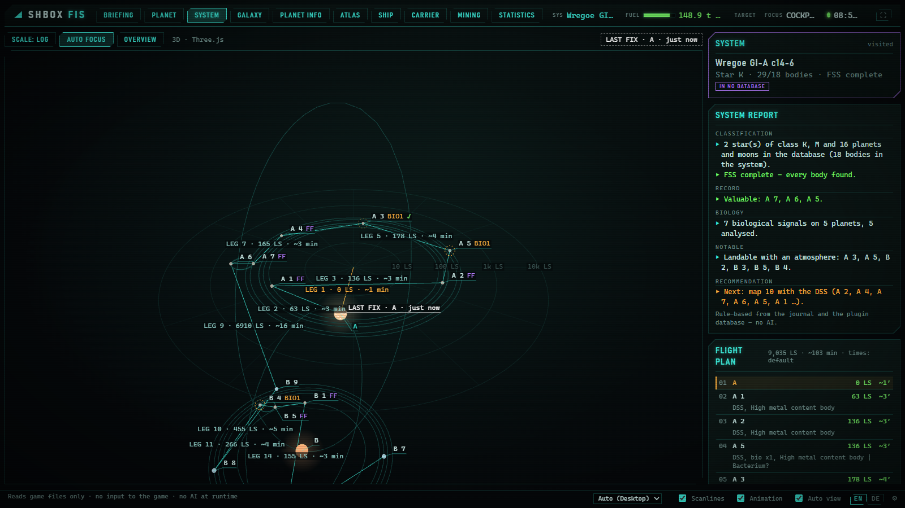
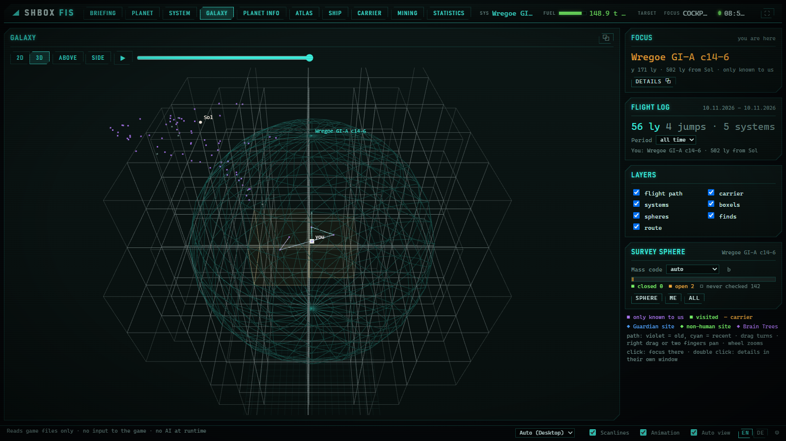
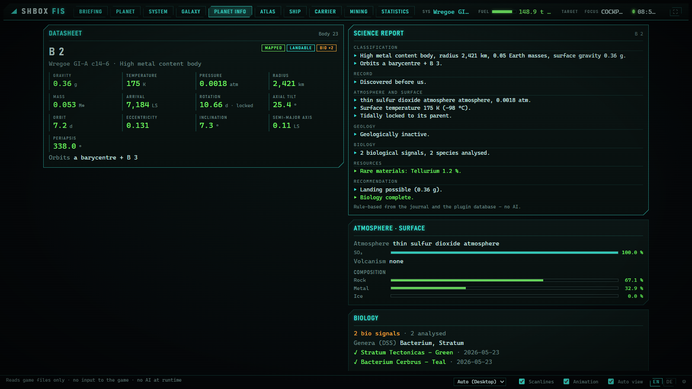
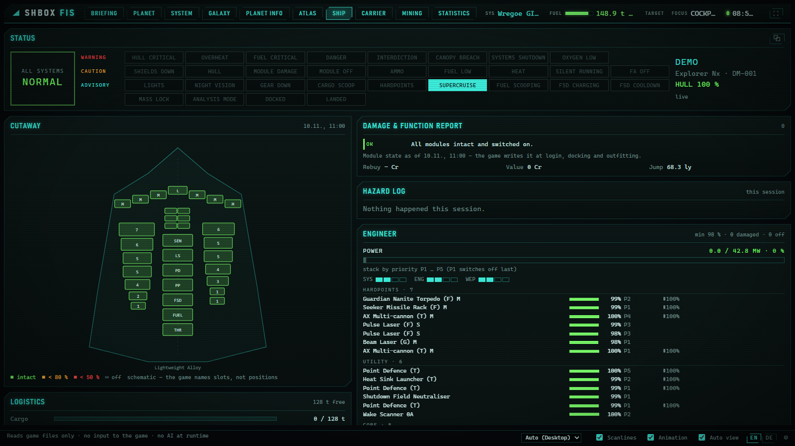
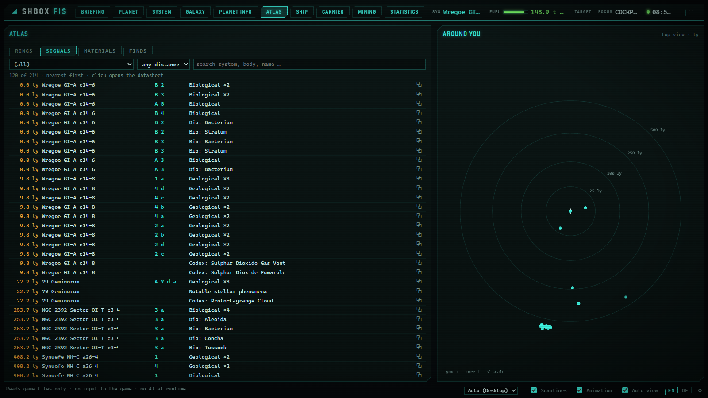

# SHBOX FIS – flight information system

> **AI disclosure (Art. 50 EU AI Act):** developed with the help of the AI
> assistant Claude (Anthropic); every change is reviewed and tested in the game
> by the developer. The FIS contains no AI system, sends no data to any AI
> service, and what it shows is not AI-generated. Details:
> [../AI_TRANSPARENCY.md](../AI_TRANSPARENCY.md)

A browser-based companion to the SHBOXSEARCH plugin: a second screen, a tablet
or a phone shows your ship, your system, your survey and your way through the
galaxy while you fly. It ships inside the plugin folder and uses the plugin's
own database and maths.

**It only reads.** The plugin database (opened read-only), the game's journal
and its state files (`Status.json`, `NavRoute.json`, `ModulesInfo.json`,
`Cargo.json`, ...). It sends nothing to the game and automates nothing. It
asks a service on the internet in one case only: when you click *online* at a
favourite carrier in CARRIER - one request to Spansh for where someone last
reported it, through the plugin's polite gateway (pacing, the daily cap shared
with the plugin, the plugin's *offline* switch), at most once per carrier
every six hours. The 3D library Three.js (0.170.0, MIT) ships
with it in `web/vendor/three` - licence and origin in `SOURCE.md` there - so
the 3D views work offline too. The QR code on the settings page is drawn
with Project Nayuki's QR Code generator (`fis/vendor/qrcodegen.py`, MIT,
licence header kept - origin in `fis/vendor/SOURCE.md`). The FIS itself is
under the Mozilla Public License 2.0 like the plugin (`LICENSE` in the plugin folder).

## Screenshots

Demo data: a copy of a real plugin database with the commander's current
area, carrier, earnings and surface tracks removed; commander and ship are
called DEMO, the position is Wregoe GI-A c14-6. 1600 × 900, English.

**SYSTEM** - the system in 3D with Kepler orbits, flight plan legs, bio and
first-footfall marks, and a rule-based system report.



**GALAXY** - the survey sphere and its boxels in 3D, flight path, known
systems; the focus panel and flight log on the right.



**PLANET INFO** - datasheet, science report, atmosphere and surface, biology
of the selected body.



**SHIP** - status lamps from `Status.json`, schematic cutaway, damage and
function report, engineer view of power and module health.



**ATLAS** - signals, rings, materials and finds of every known body, nearest
first, with a top view around you.



## Start

You need **Python 3.11 or newer** (python.org; 3.10 works, but cannot read the
plugin's route filters). EDMC's built-in Python cannot run the FIS.

Double-click **`start_fis.bat`** in `SHBOXSEARCH\FIS`. The first start asks a
few questions in the console, once:

* language (English / Deutsch - the browser can switch any time, footer EN | DE)
* who may open the FIS: only this PC, or also devices in your home network
* open the browser when the FIS starts
* port (default 8770); whether the plugin database and journal folder are found

The answers are kept in `fis.ini` next to `start_fis.bat`. Change them on the
**settings page** - the gear at the bottom of the FIS, on the game PC only
(default language, open the browser at start, home network with the address
for your tablet) - or with **`fis_settings.bat`** (which can also add the
firewall rule). No command-line parameters needed.

Or from EDMC: *File > Settings > SHBOXSEARCH*, section **SHBOX FIS** -
**start FIS**, **open in browser**, and the tick **start the FIS together with
EDMC** (off by default; the console window then opens minimised, a few seconds
after EDMC). The FIS keeps running when EDMC closes; the next EDMC start sees
it running and leaves it alone.

Updating: replace the plugin folder's files with the new release as usual
(do not delete the folder) - `fis.ini` and the plugin database stay.

### Home network (tablet, second PC, phone)

Choose "this PC and devices in the home network" in the first-start questions.

* A random **access token** is created and kept in `fis.ini`. Each device needs
  it once (the address with `?token=...`); afterwards a cookie remembers it.
* At every start the console prints the addresses of this PC, e.g.
  `http://192.168.1.20:8770/?token=...`. The footer in the browser shows the
  address (never the token).
* The **settings page** (on the game PC) shows the addresses with a **QR
  code** next to them - point the tablet camera at it instead of typing the
  token. Only the game PC gets the QR code; other devices are refused.
  **New access token** there locks out every device with the old one.
* Devices in the home network are braked: at most 120 requests in 10 s,
  and after 20 wrong tokens in 10 minutes nothing for 10 minutes. The game
  PC itself is never braked.
* **Firewall:** the FIS checks - read only - whether an enabled Windows
  Firewall rule allows TCP on its port (any rule, whatever its name). If not, it
  asks **once** whether to create the rule "SHBOX FIS": only with your yes,
  through Windows' own admin prompt (UAC), limited to the FIS port, the
  *private* profile and the *local subnet*. A "no" is remembered;
  `fis_settings.bat` asks again.

### Screens

The layout follows the window: **desktop**, **tablet** (e.g. 10", portrait or
landscape) or **phone**. Pick it by hand in the footer if you like. Every view
also opens **on its own** (button ⧉, or the address `/?solo=ship`) - without
header and footer, for a second screen or a tablet. **⛶** or key **F** goes
full screen (browsers allow that only after a click or key press). On an iPad
or iPhone, "Add to Home Screen" opens the FIS without browser bars.

On the game PC the FIS can also be **installed as an app** (Chrome, Edge):
settings page → APP → *install as app*, or the browser menu. It then opens in
its own window with a taskbar icon. Nothing is stored offline - the FIS
service has to run as usual, and an update shows at the next start. Browsers
offer this only on the PC itself (localhost), not over the home network.

While you fight, the status bar says so - from Status.json and the journal:
**READY · ANALYSIS** (amber: hardpoints out with the HUD in analysis mode -
the scanners are out, not the weapons), **COMBAT MODE** (red outline:
hardpoints out with the HUD in combat mode) or **COMBAT** (red, blinking:
under attack, shields down, hull hit, interdiction - whatever the HUD); it
calms down by itself 30 s after the last hit.

### Cockpit

For extra screens on the game PC: the settings page has **COCKPIT** - a list
of windows, each with a view, a screen, position, size and zoom, stored in
this browser. **open cockpit** opens them all at once, each without the window
control; **close cockpit** closes them again. Chrome and Edge place windows on
another screen after **detect screens** (the browser asks once whether the
page may manage windows); other browsers open them on this screen. If some
stay closed, allow pop-ups for the FIS page and click again.

### Themes

The footer picks a theme for this browser (the tablet and the PC can differ):
*standard*, *Federation console* (warm console colours), *Belt industrial*
(worn metal, teal and brass), *Station era* (blue consoles) and *Next* with an
accent colour of your own. A theme repaints the interface only - stars and
planets keep their real colours. Changing it reloads the page.

### Display links and OBS

The settings page (game PC) has **DISPLAY LINKS**: pick a view, tick **OBS
browser source** (transparent background, no scanlines, no window control)
or **without the window control** (a wall screen), choose the size (75-200 %)
and copy or open the address. In OBS: *Sources → + → Browser*, paste the
address, set width and height. With the home network on, the address
contains the access token - keep it out of the stream picture.

## Views

| Key | View | What it shows |
|---|---|---|
| 1 | **BRIEFING** | the jump target: distance, star and scoopable, whether any database knows it, what the neighbours in its boxel held, fuel after the jump, open boxel candidates, the plotted route |
| 2 | **PLANET** | the surface of a body: your track (ship, SRV, on foot), finds, colony circles for exobiology sampling, where the SRV is parked or the ship waits, Rhino mining rigs (Rig 1, 2 ... per launch, with tonnes) |
| 3 | **SYSTEM** | the current system in 3D at its Kepler positions, the course line in the plugin's order with leg times, your last position fix, biology per body, points of interest from your own journals (stations, settlements with a ⌂ on their body, fleet carriers seen there - the latest eight -, nav beacons) |
| 4 | **GALAXY** | your flight path through the galaxy over time, the carrier's path and where it is now (with a pending jump), survey spheres with the status of every boxel, visited systems, notable finds; flat map or 3D with a replay of the flight path; starts on your system, a click moves the focus, a double click opens the system as a detail window; *copy name* copies the focused system for the game's galaxy map (on a tablet over the home network the browser may refuse the clipboard - then the name shows selected, to copy by hand) |
| 5 | **PLANET INFO** | datasheet of a body: gravity, temperature, atmosphere, volcanism, materials, rings and hotspots, signals, species, genus forecast; opens on the body of your last fix; under each ring what your prospected rocks held there and what rocks of rings like it held at such hotspots; GROUND MINING: what your Rhino rigs yielded here and on bodies of the same class |
| 6 | **ATLAS** | everything found, by kind - ring hotspots, body signals, materials picked up, finds on the ground, bio signals - nearest first, within a chosen distance; SYSTEMS lists the survey sphere by state (not visited, visited, surveyed, known to no online source, checked and not existing) and exports it as CSV or JSON |
| 7 | **SHIP** | status panel (warning / caution / advisory lamps), schematic cutaway, power by priority, modules with integrity and ammunition, damage and function report, cargo and fuel |
| 8 | **CARRIER** | your fleet carrier as a ship's sheet: position and jumps, tritium and range (with the tritium in your ship and - from EDMC's Frontier data - in the carrier's hold, what you mined and the trip to your route's end), hold with its goods, finances, services - and the air wing: every ship in the hangar with role ratings (combat, mining, transport, exploration, passengers, search and rescue); docked at someone else's carrier: what its market buys (what you carry first, tritium next) and sells, from the market you opened; **known carriers** - also without a carrier of your own: the carriers you docked at, started a mission or community goal from, rode along with or saw in the FSS, with their last known system, how old that is and how far from you, what you started there and what their market bought when you last opened it. Mark the ones you want to find again with ☆ (and a note); favourites come first, get a ★ in SYSTEM's points of interest and on the GALAXY map |
| 9 | **MINING** | everything about mining, tritium first: the session (yield per hour, limpets, best and last rock), tritium for the carrier (tank, in your ship, mined, delivered), ring hotspots near you, mining ships, goods with what selling them earned against the carrier's upkeep, every session so far |
| 0 | **STATISTICS** | the game's own record of you (written at every login): ranks with progress, exploration, exobiology, mining, the carrier, wealth and time played - with the growth over 24 h, 7, 30 or 90 days |

Planet, system, galaxy: the same place at three scales. Addresses work with the
names too (`/#system`, `/#planetinfo`, `/#stats`).

Notes on what the files allow:

* Module integrity and ammunition are written by the game at login, docking
  and outfitting - the SHIP view shows them with that time, not live in combat.
  Shield strength and heat in percent are not in the files.
* The cutaway is a schematic: the game names slots, not their positions on the
  hull.
* Ship fittings are known for ships flown since your journals begin.
* The carrier's tritium use per jump is computed with a formula fitted on
  real jumps (within 1 t). Tritium in the carrier's hold and the exact weekly
  upkeep come from EDMC's Frontier data (Companion API) once EDMC has fetched
  it; without it the weekly cost is an estimate from the balance over time.
* The live link watches itself: if the game writes its journal anew under the
  same name (seen after a lost connection), the FIS reads the new file from
  its start; a reader that stopped is started again; a page whose connection
  went silent (tablet asleep, Wi-Fi) reconnects within about 40 seconds.
* The route uses the same filters as the plugin (read from EDMC's settings).
* If one journal folder holds several commanders, the FIS shows the one who
  logged in last.
* Known carriers come only from your own journals - nothing is looked up
  online, so a carrier's position is where *you* last saw it. Favourites,
  notes and the last market of each visited carrier are kept per commander
  in `favourites.json` next to `fis.ini` (personal - keep it out of anything
  you share). Starring works from the tablet too (with the home-network
  token); the settings stay on the game PC.

## Files

```
start_fis.bat      start (first start asks, then remembers)
fis_settings.bat   change the settings
fis.ini.example    every setting, explained
fis/               the server (Python standard library only)
web/               the pages (no build step)
tests/             python -m unittest discover -s tests -t .  (not needed to run)
```

Settings beyond the questions (all optional) are listed in `fis.ini.example`.

## For developers

`python -m fis --help` lists parameters for development (`--db`, `--journal`,
`--port`, `--no-setup` ...). `/api/health` reports the state of database,
journal, live connections and the watchdog (reader alive, last poll, journal
rewrites, restarts); `/api/config` the language and home-network
addresses. Tests: `python -m unittest discover -s tests -t .` from this folder.
